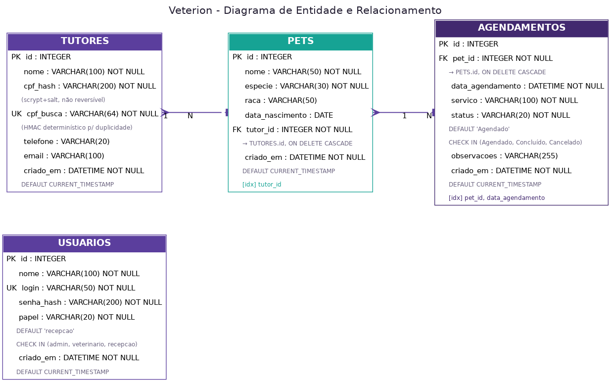
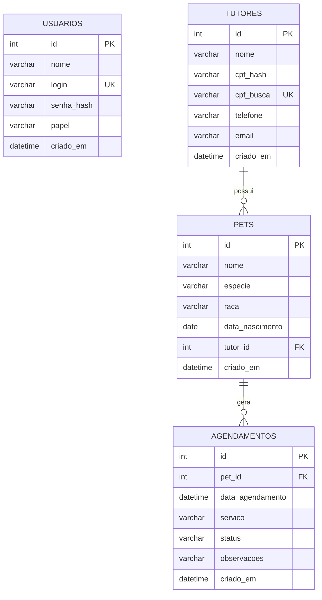

# Diagrama de Entidade e Relacionamento (DER) — Veterion

Elaborado a partir do schema real em [`db/schema.sql`](../db/schema.sql),
usado pelo backend (`backend/src/db.js`) para criar o banco SQLite na
primeira execução.

## Diagrama

O PNG acima foi gerado a partir do arquivo-fonte [`der.dot`](der.dot)
(Graphviz: `dot -Tpng der.dot -o der.png`). Abaixo também há uma versão
equivalente em Mermaid, útil para editar em ferramentas que renderizam esse
formato (ex: GitHub, editores com plugin Mermaid).

> `USUARIOS` representa os operadores do sistema (administração, veterinários
> e recepção) e não se relaciona diretamente com as demais entidades — é usada
> apenas para autenticação.

## Entidades e atributos

### USUARIOS
Quem acessa o sistema (login).

| Atributo    | Tipo         | Restrições                                                        |
|-------------|--------------|----------------------------------------------------------------------|
| id          | INTEGER      | **PK**, autoincremento                                                 |
| nome        | VARCHAR(100) | NOT NULL                                                                |
| login       | VARCHAR(50)  | NOT NULL, **UNIQUE**                                                    |
| senha_hash  | VARCHAR(200) | NOT NULL (hash com salt — scrypt; nunca texto puro)                    |
| papel       | VARCHAR(20)  | NOT NULL, `DEFAULT 'recepcao'`, `CHECK IN ('admin','veterinario','recepcao')` |
| criado_em   | DATETIME     | NOT NULL, `DEFAULT CURRENT_TIMESTAMP`                                   |

### TUTORES
Responsáveis pelos pets.

| Atributo   | Tipo         | Restrições                                                                 |
|------------|--------------|---------------------------------------------------------------------------|
| id         | INTEGER      | **PK**, autoincremento                                                     |
| nome       | VARCHAR(100) | NOT NULL                                                                   |
| cpf_hash   | VARCHAR(200) | NOT NULL (hash protegido com salt — scrypt; não reversível)                |
| cpf_busca  | VARCHAR(64)  | NOT NULL, **UNIQUE** (HMAC determinístico, usado só para checar duplicidade de CPF) |
| telefone   | VARCHAR(20)  | opcional                                                                   |
| email      | VARCHAR(100) | opcional (formato validado na API)                                         |
| criado_em  | DATETIME     | NOT NULL, `DEFAULT CURRENT_TIMESTAMP`                                      |

### PETS
Animais atendidos pela clínica.

| Atributo        | Tipo        | Restrições                                                      |
|-----------------|-------------|-------------------------------------------------------------------|
| id              | INTEGER     | **PK**, autoincremento                                             |
| nome            | VARCHAR(50) | NOT NULL                                                           |
| especie         | VARCHAR(30) | NOT NULL                                                           |
| raca            | VARCHAR(50) | opcional                                                           |
| data_nascimento | DATE        | opcional                                                           |
| tutor_id        | INTEGER     | NOT NULL, **FK → TUTORES.id**, `ON DELETE CASCADE`                     |
| criado_em       | DATETIME    | NOT NULL, `DEFAULT CURRENT_TIMESTAMP`                                  |

Índice: `idx_pets_tutor` em `tutor_id`.

### AGENDAMENTOS
Atendimentos marcados para um pet.

| Atributo         | Tipo         | Restrições                                                                 |
|------------------|--------------|---------------------------------------------------------------------------|
| id               | INTEGER      | **PK**, autoincremento                                                     |
| pet_id           | INTEGER      | NOT NULL, **FK → PETS.id**, `ON DELETE CASCADE`                                |
| data_agendamento | DATETIME     | NOT NULL                                                                   |
| servico          | VARCHAR(100) | NOT NULL                                                                   |
| status           | VARCHAR(20)  | NOT NULL, `DEFAULT 'Agendado'`, `CHECK IN ('Agendado','Concluído','Cancelado')` |
| observacoes      | VARCHAR(255) | opcional                                                                   |
| criado_em        | DATETIME     | NOT NULL, `DEFAULT CURRENT_TIMESTAMP`                                      |

Índices: `idx_agendamentos_pet` em `pet_id`; `idx_agendamentos_data` em `data_agendamento`.

## Cardinalidades e integridade referencial

- Um **tutor** pode ter **zero ou vários** pets; um **pet** pertence a **exatamente um** tutor (`1:N`).
- Um **pet** pode ter **zero ou vários** agendamentos; um **agendamento** pertence a **exatamente um** pet (`1:N`).
- Ambas as chaves estrangeiras usam `ON DELETE CASCADE`: excluir um tutor
  remove seus pets e, em cascata, os agendamentos desses pets; excluir um pet
  remove seus agendamentos.
- `USUARIOS` é uma entidade independente (sem FK de/para as demais), usada
  apenas para autenticação.
