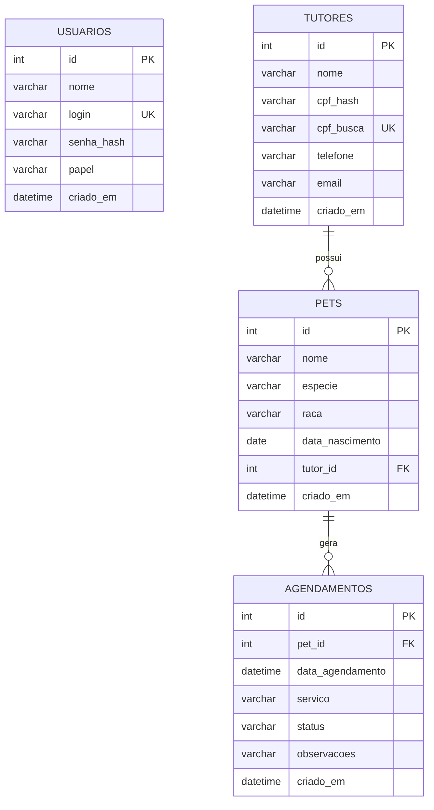

# Diagrama de Entidade e Relacionamento (DER) — Veterion

## Diagrama

> `USUARIOS` representa os operadores do sistema (administração, veterinários
> e recepção) e não se relaciona diretamente com as demais entidades — é usada
> apenas para autenticação/autorização.

## Entidades e atributos

### USUARIOS
Representa quem acessa o sistema (login).

| Atributo    | Tipo         | Restrições                                  |
|-------------|--------------|----------------------------------------------|
| id          | INTEGER      | PK, autoincremento                            |
| nome        | VARCHAR(100) | obrigatório                                   |
| login       | VARCHAR(50)  | obrigatório, único                            |
| senha_hash  | VARCHAR(200) | obrigatório (hash com salt, nunca em texto puro) |
| papel       | VARCHAR(20)  | obrigatório; `admin`, `veterinario` ou `recepcao` |
| criado_em   | DATETIME     | preenchido automaticamente                    |

### TUTORES
Responsáveis pelos pets.

| Atributo   | Tipo         | Restrições                                              |
|------------|--------------|-----------------------------------------------------------|
| id         | INTEGER      | PK, autoincremento                                         |
| nome       | VARCHAR(100) | obrigatório                                                |
| cpf_hash   | VARCHAR(200) | obrigatório (hash protegido, não reversível)               |
| cpf_busca  | VARCHAR(64)  | obrigatório, único (hash determinístico só para checar duplicidade de CPF) |
| telefone   | VARCHAR(20)  | opcional                                                   |
| email      | VARCHAR(100) | opcional, formato validado                                 |
| criado_em  | DATETIME     | preenchido automaticamente                                 |

### PETS
Animais atendidos pela clínica.

| Atributo        | Tipo        | Restrições                              |
|-----------------|-------------|------------------------------------------|
| id              | INTEGER     | PK, autoincremento                        |
| nome            | VARCHAR(50) | obrigatório                               |
| especie         | VARCHAR(30) | obrigatório                               |
| raca            | VARCHAR(50) | opcional                                  |
| data_nascimento | DATE        | opcional                                  |
| tutor_id        | INTEGER     | FK → TUTORES.id, obrigatório, `ON DELETE CASCADE` |
| criado_em       | DATETIME    | preenchido automaticamente                |

### AGENDAMENTOS
Atendimentos marcados para um pet.

| Atributo         | Tipo         | Restrições                                                        |
|------------------|--------------|----------------------------------------------------------------------|
| id               | INTEGER      | PK, autoincremento                                                    |
| pet_id           | INTEGER      | FK → PETS.id, obrigatório, `ON DELETE CASCADE`                        |
| data_agendamento | DATETIME     | obrigatório                                                           |
| servico          | VARCHAR(100) | obrigatório                                                           |
| status           | VARCHAR(20)  | obrigatório; `Agendado` (padrão), `Concluído` ou `Cancelado`          |
| observacoes      | VARCHAR(255) | opcional                                                              |
| criado_em        | DATETIME     | preenchido automaticamente                                            |

## Cardinalidades

- Um **tutor** pode ter **zero ou vários** pets; um **pet** pertence a **exatamente um** tutor (`1:N`).
- Um **pet** pode ter **zero ou vários** agendamentos; um **agendamento** pertence a **exatamente um** pet (`1:N`).
- Excluir um tutor remove em cascata seus pets e, por consequência, os agendamentos desses pets.
